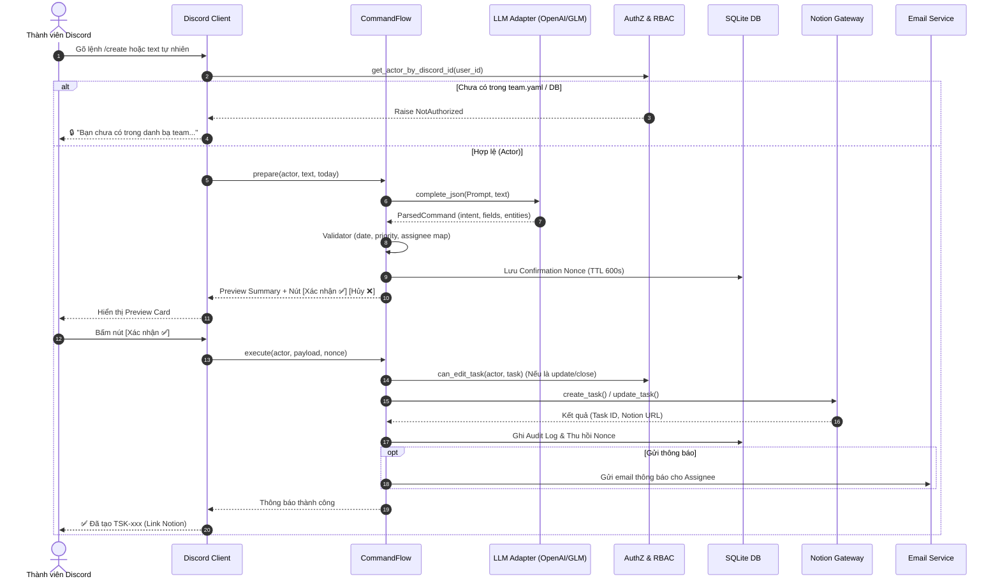
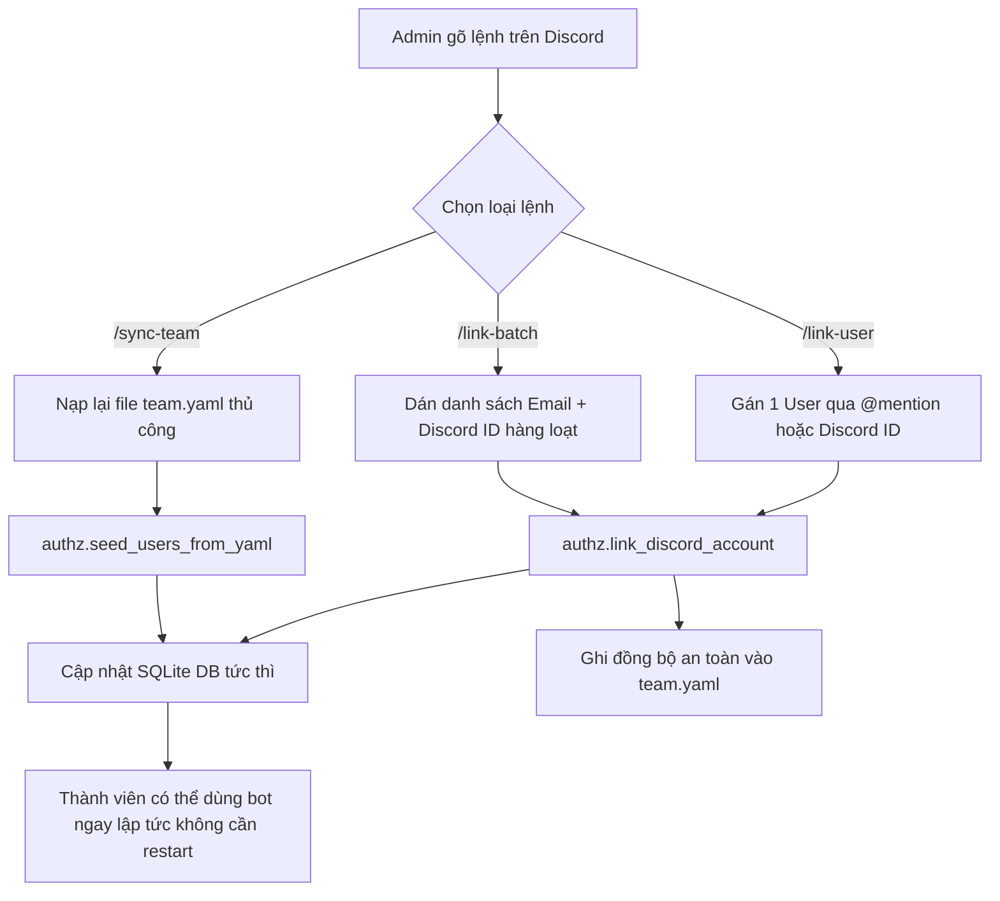

# TÀI LIỆU KIẾN TRÚC HỆ THỐNG & ĐÁNH GIÁ LỖ HỔNG (SECURITY & ARCHITECTURE AUDIT)

> **Dự án**: SEE Notion — Hệ thống Quản trị Task Notion, Nhắc Deadline & Tự động hoá qua Discord Bot  
> **Cập nhật ngày**: 09/11/2026  
> **Phiên bản**: v2.1-production  

---

## 1. TỔNG QUAN KIẾN TRÚC HỆ THỐNG (SYSTEM ARCHITECTURE)

Hệ thống được thiết kế theo mô hình **Hexagonal Architecture (Ports and Adapters)** kết hợp **Domain-Driven Design (DDD)** gọn nhẹ, gói gọn trong 1 tiến trình duy nhất (Single-Process Service) phục vụ trên môi trường Alwaysdata/Linux.

```
                              ┌───────────────────────────────────────────────┐
                              │            CÁC ĐẦU VÀO (INBOUND)              │
                              │  • Discord Slash Commands (/create, /update) │
                              │  • REST API Client (Bearer Token Auth)        │
                              │  • APScheduler (Cron quét deadline định kỳ)   │
                              └───────────────────────┬───────────────────────┘
                                                      │
                                                      ▼
                              ┌───────────────────────────────────────────────┐
                              │          LỚP TRUYỀN DẪN (ADAPTERS)            │
                              │  • discord_client.py  • routers.py            │
                              └───────────────────────┬───────────────────────┘
                                                      │
                                                      ▼
                              ┌───────────────────────────────────────────────┐
                              │           LỚP ĐIỀU PHỐI (SERVICES)            │
                              │  • parser.py (LLM Natural Language Parsing)   │
                              │  • validator.py (Kiểm tra nghiệp vụ & ngày)   │
                              │  • authz.py (RBAC: Admin / Member / Task owner│
                              │  • command_flow.py (Orchestrator 2 giai đoạn) │
                              │  • reminder_engine.py (Tính toán rule nhắc)   │
                              └───────┬───────────────────────────────┬───────┘
                                      │                               │
                                      ▼                               ▼
       ┌─────────────────────────────────────────┐ ┌─────────────────────────────────────────┐
       │         LỚP DỮ LIỆU & NỘI BỘ            │ │       CÁC DỊCH VỤ NGOÀI (OUTBOUND)      │
       │  • SQLite (users, pending_actions,      │ │  • notion_gateway.py (RateLimit/Retry)  │
       │    notification_log, audit_log)         │ │  • llm/ (OpenAI / GLM / Ollama)         │
       │  • team.yaml (Danh bạ team nguồn)       │ │  • email/ (SMTP Gmail / Resend)         │
       └─────────────────────────────────────────┘ └─────────────────────────────────────────┘
```

---

## 2. WORKFLOW HOẠT ĐỘNG CHI TIẾT (END-TO-END RUNTIME WORKFLOW)

### 2.1. Quy trình thực thi lệnh tự nhiên (`/create`, `/update`, `/complete`)



---

### 2.2. Quy trình Quét và Nhắc Deadline tự động (`scheduler.py`)

1. **Trigger**: APScheduler chạy mỗi `reminder_cron_minutes` (mặc định 5 phút).
2. **Lấy danh sách task mở**: `notion_gateway.query_open_tasks()` lấy các task có status khác `Done`/`Cancelled`/`Archived`.
3. **Phân tích Offset ngày**: `reminder_engine.py` tính khoảng cách từ hôm nay đến `deadline`:
   - `before_3d` (3 ngày trước)
   - `before_1d` (1 ngày trước)
   - `due_today` (đúng ngày đến hạn)
   - `overdue_1d`, `overdue_3d` (quá hạn)
4. **Kiểm tra chống gửi trùng (Deduplication Lock)**: Truy vấn bảng `notification_log` trong SQLite theo `(task_ref, rule_key, due_date)`. Nếu đã gửi `SENT` thì bỏ qua.
5. **Gửi thông báo**:
   - Gửi Discord DM (nếu user có `discord_id` và bật `prefs.discord_dm`).
   - Gửi Email sinh viên (nếu bật `prefs.email`).

---

### 2.3. Quy trình Quản trị Thành viên (`/link-user`, `/link-batch`, `/sync-team`)



---

## 3. BẢNG ĐÁNH GIÁ LỖ HỔNG & RỦI RO CHI TIẾT TỪNG FILE (CODEBASE AUDIT)

### 3.1. Nhóm Adapters (`app/adapters/`)

| File | Chức năng | Các lỗ hổng tiềm ẩn & Rủi ro | Giải pháp & Trạng thái |
|---|---|---|---|
| [`discord_client.py`](file:///c:/Users/Acer/Desktop/My%20carrer/SEE%20Notion/app/adapters/discord_client.py) | Nhận sự kiện, slash commands, views | 1. **Arbitrary File Read**: Lệnh `/bulk-create` từng cho phép đọc file server local qua đường dẫn máy chủ.<br>2. **Unhandled Exceptions**: Bắt lỗi `except Exception: pass` nuốt lỗi.<br>3. **Blocking I/O**: Đọc file đồng bộ trong hàm async. | 1. **Đã vá**: Chặn đọc local path, chỉ nhận URL hoặc Discord Attachment.<br>2. Đã thêm log error và phản hồi ephemeral thân thiện.<br>3. Đã chuyển sang async client. |
| [`notion_gateway.py`](file:///c:/Users/Acer/Desktop/My%20carrer/SEE%20Notion/app/adapters/notion_gateway.py) | Tương tác Notion REST API, Pagination, Rate limit | 1. **Token Invalidation**: Nếu Notion token bị đổi/thu hồi, gateway ném `NotionError` nhưng bot không fallback được.<br>2. **Notion Schema Drift**: Nếu database Notion bị xóa cột hoặc đổi tên cột `Assignee`/`Status` sẽ gãy parser. | Cần bọc schema validation khi parse properties; bot đã có log chi tiết lỗi từ API Notion. |
| [`email/smtp.py`](file:///c:/Users/Acer/Desktop/My%20carrer/SEE%20Notion/app/adapters/email/smtp.py) | Gửi mail qua SMTP | 1. **Blocking Network Call**: Dùng `aiosmtplib` async chuẩn, tuy nhiên nếu SMTP server timeout có thể giữ kết nối lâu. | Thiết lập timeout cứng 10s cho mỗi lần connect SMTP. |
| [`llm/openai_adapter.py`](file:///c:/Users/Acer/Desktop/My%20carrer/SEE%20Notion/app/adapters/llm/openai_adapter.py) | Kết nối LLM tương thích OpenAI (GLM / DeepSeek / GPT) | 1. **Prompt Injection**: Đầu vào từ người dùng có thể chứa jailbreak ép bot xuất JSON sai.<br>2. **Malformed JSON**: LLM trả về text không parse được thành JSON. | 1. Đã cô lập bằng System Prompt nghiêm ngặt.<br>2. Đã bọc `json.loads` và validate bằng Pydantic model (`ParsedCommand`). |

---

### 3.2. Nhóm Services (`app/services/`)

| File | Chức năng | Các lỗ hổng tiềm ẩn & Rủi ro | Giải pháp & Trạng thái |
|---|---|---|---|
| [`command_flow.py`](file:///c:/Users/Acer/Desktop/My%20carrer/SEE%20Notion/app/services/command_flow.py) | Điều phối luồng lệnh, Preview, Confirmation, Execution | 1. **Thiếu RBAC Check**: Từng không gọi `can_edit_task`, dẫn tới member sửa/archive task của người khác.<br>2. **Keyword repeated (Crash)**: Từng lặp tham số `title` gây crash startup. | 1. **Đã vá**: Ép buộc gọi `can_edit_task` ở cả giai đoạn prepare và execute.<br>2. **Đã vá**: Sửa triệt để cú pháp tham số. |
| [`authz.py`](file:///c:/Users/Acer/Desktop/My%20carrer/SEE%20Notion/app/services/authz.py) | Quản lý danh tính, RBAC, map user, link discord | 1. **Race Condition khi sửa YAML**: Nếu 2 admin gọi link cùng lúc có thể conflict file.<br>2. **Unique Constraint**: Lỗi khi 2 email trùng hoặc 2 người dùng chung Discord ID. | 1. Đã regex trực tiếp block cần sửa thay vì dump đè toà bộ file.<br>2. Đã thêm kiểm tra `existing_discord` trước khi gán. |
| [`confirmation.py`](file:///c:/Users/Acer/Desktop/My%20carrer/SEE%20Notion/app/services/confirmation.py) | Sinh token Nonce xác nhận 2 bước | 1. **Replay Attack**: User bấm nhiều lần cùng 1 nonce.<br>2. **Nonce Hijack**: Người khác bấm vào nút xác nhận của bạn. | 1. Nonce được tiêu hủy ngay lập tức sau lần thực thi đầu tiên.<br>2. View Discord chỉ chấp nhận `interaction.user.id == requester_id`. |
| [`reminder_engine.py`](file:///c:/Users/Acer/Desktop/My%20carrer/SEE%20Notion/app/services/reminder_engine.py) | Engine tính toán lịch nhắc hẹn | 1. **Spam lặp nhắc**: Nếu DB lưu trạng thái fail, cron quét lại có thể gửi liên tục.<br>2. **Timezone mismatch**: Tính sai ngày lệch do server UTC và ICT (GMT+7). | 1. Đã có bảng `notification_log` deduplication.<br>2. Ép buộc sử dụng `business_tz` (Asia/Ho_Chi_Minh). |
| [`template_parser.py`](file:///c:/Users/Acer/Desktop/My%20carrer/SEE%20Notion/app/services/template_parser.py) | Parse Meeting Minutes & File DOCX / CSV | 1. **Billion Laughs / XML Entity Bomb**: Parse DOCX (thực chất là zip chứa XML) có thể bị khai thác nếu dùng parser không an toàn.<br>2. **Cột bảng sai format**. | Dùng `xml.etree.ElementTree` an toàn mặc định trong Python 3; bắt `LayoutParseError` rõ ràng. |
| [`validator.py`](file:///c:/Users/Acer/Desktop/My%20carrer/SEE%20Notion/app/services/validator.py) | Validate ngày tháng, priority, tên thành viên | 1. **Ambiguous Assignee**: Nhiều bạn trùng tên (ví dụ: 2 bạn Thảo Nguyên) có thể gán nhầm. | Đã bắt buộc dùng họ tên đầy đủ hoặc báo danh sách gợi ý để người dùng chọn chính xác. |

---

### 3.3. Nhóm Cơ Sở Dữ Liệu & Cấu Hình (`app/db/`, `app/api/`, `app/`)

| File | Chức năng | Các lỗ hổng tiềm ẩn & Rủi ro | Giải pháp & Trạng thái |
|---|---|---|---|
| [`routers.py`](file:///c:/Users/Acer/Desktop/My%20carrer/SEE%20Notion/app/api/routers.py) | REST API endpoints | 1. **Timing Attack**: So sánh API token bằng `!=`.<br>2. **Unauthorized Access**: Thiếu token bảo vệ endpoint kiểm tra task. | 1. **Đã vá**: Đổi sang `secrets.compare_digest`.<br>2. Tất cả router nghiệp vụ đều có `Depends(require_token)`. |
| [`models.py`](file:///c:/Users/Acer/Desktop/My%20carrer/SEE%20Notion/app/db/models.py) & [`session.py`](file:///c:/Users/Acer/Desktop/My%20carrer/SEE%20Notion/app/db/session.py) | SQLAlchemy SQLite Models | 1. **Database Lock**: SQLite bị lock do nhiều luồng Discord + FastAPI đồng thời.<br>2. **Mất DB khi deploy**: Database SQLite nằm cùng container, nếu redeploy không mount volume có thể mất dữ liệu. | 1. Cấu hình `check_same_thread=False` và timeout 30s.<br>2. Toàn bộ nguồn sự thật chính lưu ở `team.yaml` và Notion Database, DB SQLite có thể tự seed lại bất kỳ lúc nào qua `/sync-team`. |
| [`config.py`](file:///c:/Users/Acer/Desktop/My%20carrer/SEE%20Notion/app/config.py) | Pydantic Settings & Đọc `.env` | 1. **Hardcoded Secrets**: Lộ secret lên git repository. | Toàn bộ secret nằm trong `.env` (được đưa vào `.gitignore`), dùng Pydantic `BaseSettings` validate kiểu dữ liệu. |

---

## 4. KHUYẾN NGHỊ VẬN HÀNH & BẢO TRÌ (OPERATIONAL RECOMMENDATIONS)

1. **Khi có thành viên mới vào CLB**:
   - Thêm vào [team.yaml](file:///c:/Users/Acer/Desktop/My%20carrer/SEE%20Notion/team.yaml) với email VGU và `notion_user_id` (được share vào workspace Notion).
   - Trên Discord, gõ `/sync-team` để nạp ngay vào hệ thống.
   - Khi bạn đó tham gia Discord, Admin dùng `/link-user` để gán Discord ID.
2. **Sao lưu dữ liệu**:
   - `team.yaml` đã được version control trên GitHub.
   - Task và Deadline thực tế đều nằm an toàn trên Notion Cloud.
3. **Giám sát log**:
   - Sử dụng lệnh `tail -f ~/admin/logs/uwsgi.log` (hoặc log Alwaysdata) để theo dõi các thông báo nhắc việc và hoạt động của bot.

